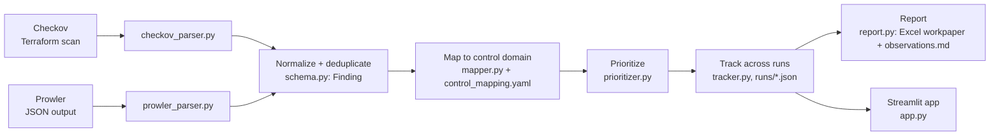
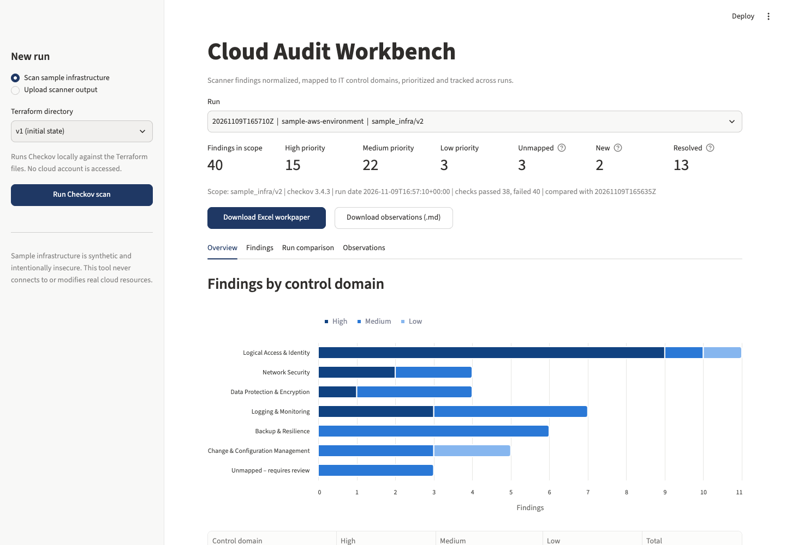
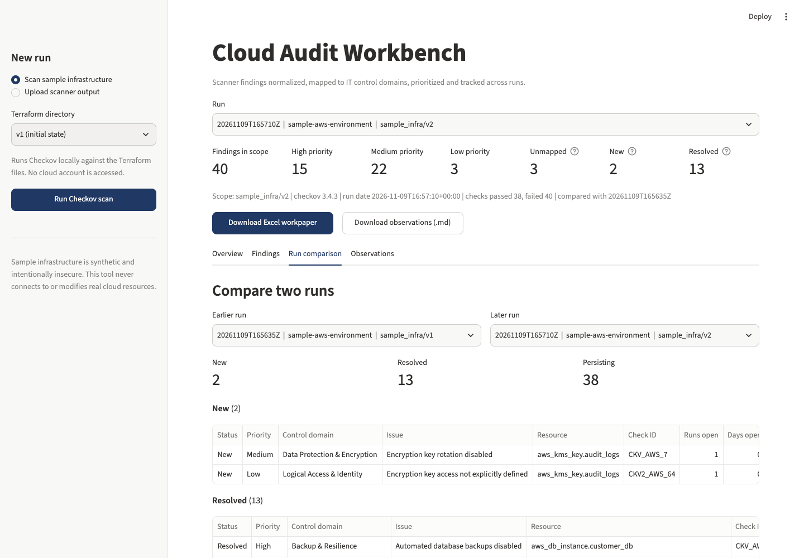
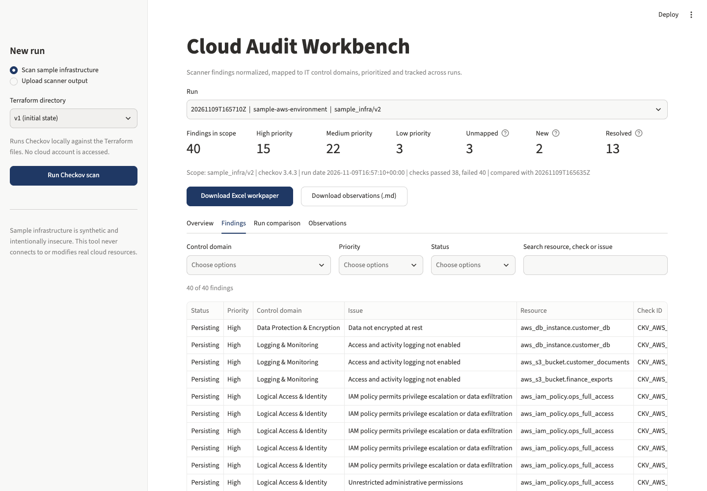

# Cloud Audit Workbench

Turns raw output from open-source cloud security scanners into audit-ready evidence: findings normalized into one schema, mapped to IT control domains, explained in business language, prioritized, tracked across scans, and exported as a workpaper.

**Project page:** https://onedotpy.github.io/cloud-audit-workbench/

> **Safety note.** Everything in `sample_infra/` is synthetic, intentionally insecure Terraform written for this project. It must never be deployed. The tool scans Terraform files locally with Checkov and reads JSON files. It never connects to, queries or modifies real cloud resources.

## The problem

Scanners such as Checkov and Prowler are good at finding misconfigurations, but their output is written for engineers: a long list of check IDs, resource addresses and rule titles. An IT auditor needs something different:

| Scanner gives you | An auditor needs |
|---|---|
| `CKV_AWS_24 FAILED aws_security_group.admin_access` | Which **control** failed (Network Security: remote admin access restricted to approved networks) |
| A rule title ("Ensure no security groups allow ingress from 0.0.0.0:0 to port 22") | The **business risk** in plain language, and a recommendation |
| A severity (sometimes; Checkov OSS leaves it empty) | A documented, explainable **priority** |
| A point-in-time list | **Remediation status** across reviews: New, Resolved, Persisting, and for how long |
| JSON | A **workpaper** with scope, evidence and sign-off fields |

Cloud Audit Workbench is that layer. It does not replace the scanner, and it does not re-perform the scanner's tests.

## Architecture



| Module | Responsibility |
|---|---|
| `src/parsers/checkov_parser.py` | Reads Checkov JSON (single framework dict or list of frameworks). Structure verified against real Checkov 3.4.3 output. |
| `src/parsers/prowler_parser.py` | Reads Prowler 4.x `json-ocsf` and Prowler 3.x native JSON. Tolerant of missing fields. |
| `src/schema.py` | Pydantic `Finding` model, stable `finding_id`, deduplication. |
| `src/control_mapping.yaml` | Editable mapping of check IDs to control domain, objective, business risk, recommendation. |
| `src/mapper.py` | Loads and validates the YAML; unmapped checks go to "Unmapped – requires review". |
| `src/prioritizer.py` | High/Medium/Low priority from scanner severity plus four documented rules. |
| `src/tracker.py` | Saves each run as `runs/<timestamp>.json`; classifies findings as New, Resolved or Persisting; computes age. |
| `src/report.py` | Excel workpaper (Summary, Findings, Resolved) and a markdown summary of observations. |
| `src/pipeline.py` | Command-line entry point that runs the steps end to end. |
| `app.py` | Streamlit UI. |

## Running it end to end

Requires Python 3.11+.

```bash
python3.11 -m venv .venv
source .venv/bin/activate
pip install -r requirements.txt

# 1. Scan the initial state, then the partially remediated state
python -m src.pipeline scan sample_infra/v1
python -m src.pipeline scan sample_infra/v2

# 2. Import scanner output you already have (Checkov or Prowler JSON)
python -m src.pipeline import tests/fixtures/prowler_sample.json --environment prowler-sample

# 3. Compare any two saved runs
python -m src.pipeline compare runs/<earlier>.json runs/<later>.json

# 4. Tests
python -m pytest

# 5. UI
python -m streamlit run app.py
```

Each `scan` or `import` prints a summary, saves the run to `runs/`, and writes `reports/workpaper_<run>.xlsx` and `reports/observations_<run>.md`. Runs are compared with the most recent earlier run in the same **environment** (v1 and v2 are both `sample-aws-environment`).

Tip: if your project path contains spaces, call tools as modules (`python -m pytest`, `python -m streamlit`, `python -m checkov.main`) because virtualenv script shebangs break on such paths.

### Output on the sample infrastructure (Checkov 3.4.3)

| | v1 (initial) | v2 (after partial remediation) |
|---|---|---|
| Resources evaluated | 11 | 12 |
| Failed checks (findings) | 51 | 40 |
| High / Medium / Low | 25 / 24 / 2 | 15 / 22 / 3 |
| Unmapped – requires review | 3 | 3 |
| v1 → v2 | | New 2, Resolved 13, Persisting 38 |

v2 fixes the public bucket, the public database, the missing database backups, CloudTrail coverage and validation, and EBS encryption. It leaves SSH/RDP open, the wildcard IAM policy and the unencrypted database in place. It also introduces one new issue: the KMS key created to encrypt CloudTrail has rotation disabled, a realistic example of remediation work introducing a new exception.

## Control domains

25 audit issues covering 54 scanner checks (45 Checkov, 9 Prowler) are mapped in `src/control_mapping.yaml`.

| Control domain | Example issue | Example checks |
|---|---|---|
| Logical Access & Identity | Unrestricted administrative permissions | CKV_AWS_62, CKV_AWS_63, CKV2_AWS_40, `iam_root_mfa_enabled` |
| Network Security | Administrative ports open to the internet | CKV_AWS_24 (SSH), CKV_AWS_25 (RDP), `ec2_securitygroup_allow_ingress_from_internet_to_tcp_port_22` |
| Data Protection & Encryption | Publicly accessible storage; data not encrypted at rest | CKV_AWS_20, CKV_AWS_53–56, CKV_AWS_16, CKV_AWS_3, CKV_AWS_7 |
| Logging & Monitoring | Audit trail does not cover all regions; access logging not enabled | CKV_AWS_67, CKV_AWS_36, CKV_AWS_18, CKV2_AWS_11 |
| Backup & Resilience | Automated database backups disabled; object versioning disabled | CKV_AWS_133, CKV_AWS_21, CKV_AWS_157 |
| Change & Configuration Management | Database patching not automated; undocumented network configuration | CKV_AWS_226, CKV_AWS_23, CKV2_AWS_5 |

Each entry records a **control objective** (what a working control achieves), the **business risk** in non-technical language, a **recommendation**, and a `default_severity` used only when the scanner provides none.

**Framework references.** The mapping deliberately contains no references to COBIT, ISO 27001, NIST, MAS TRM or any other framework, and a test enforces this. The report shows only references the scanner itself supplies (Checkov `benchmarks`, Prowler `compliance`). With open-source Checkov and no Prisma Cloud API key, `benchmarks` is empty, so the Checkov sample reports show "None provided". That is the honest result.

**Unmapped checks** are never guessed. They are reported under "Unmapped – requires review" with a count on the Summary sheet. Three are left unmapped on purpose to demonstrate this: CKV2_AWS_60, CKV2_AWS_62 and Prowler's `account_security_contact_information_is_registered`.

## Prioritization rules

All rules are in `src/prioritizer.py`, are applied in order, and are recorded per finding in the "Priority rationale" column.

1. **Baseline from scanner severity.** Critical/High → High, Medium → Medium, Low/Info → Low. If the scanner gives no severity (as with Checkov OSS), use the reviewer-set `default_severity` from the mapping. If that is also missing (unmapped check), start at Low.
2. **Data stores raise priority by one level.** S3 buckets, RDS, EBS, DynamoDB and similar resources (Low → Medium, Medium → High).
3. **Public exposure is High.** The check title or status text indicates internet exposure ("public", "0.0.0.0", "::/0", "internet"). Egress rules are excluded because they do not make a resource reachable.
4. **Logging gaps are at least Medium.** This applies to any finding in the Logging & Monitoring domain.

These rules are intentionally simple so that a reviewer can explain every priority. Their effect is visible in the output. For example, S3 access logging comes out High because it starts at Medium (mapping default), sits on a data store (+1), and is a logging gap (floor Medium).

## Remediation tracking

- `finding_id` = SHA-256 of `tool | check_id | resource` (first 16 hex characters). File paths and line numbers are excluded, so a finding keeps its ID when code moves. In the sample, the RDS resource moves from lines 6–18 to 7–19 between v1 and v2 and is still matched.
- **New**: in this run, not in the previous run. **Resolved**: in the previous run, not in this run. **Persisting**: in both.
- Age: `runs_open` counts consecutive runs containing the finding, and `days_open` is the time since it was first seen in that unbroken chain. Because the sample v1 and v2 scans run seconds apart, days open shows 0 in the demo. The tests verify the calculation with runs 30 and 60 days apart.

## Report

**Excel workpaper** (`reports/workpaper_<run>.xlsx`):
- **Summary**: W/P reference, prepared/reviewed sign-off fields, scope (target, scanner and version, resources evaluated, checks passed/failed, run date), findings by control domain × priority, comparison to the previous run, unmapped count, basis of preparation.
- **Findings**: one row per finding with status, priority, control domain, issue, control objective, condition, business risk, recommendation, priority rationale, evidence (resource, file, lines, check ID, scanner severity, scanner framework refs, guideline), age, and blank columns for management response and reviewer notes.
- **Resolved**: findings fixed since the previous run.

**Observations** (`reports/observations_<run>.md`): an overall summary in auditor voice, full Criteria / Condition / Risk / Recommendation / Status write-ups for High-priority observations (findings grouped by issue), a table of Medium and Low items, remediated items, and items requiring review.

## Prowler support

`tests/fixtures/prowler_sample.json` is a **hand-written** sample modeled on the **Prowler 4.x `json-ocsf`** output layout (the file declares product version 4.5.0). It was not produced by a live Prowler run, and I have not verified every field name against a specific Prowler release. The parser therefore looks up every field defensively and also accepts the older **Prowler 3.x native JSON** layout (`CheckID`, `Status`, `StatusExtended`, `ResourceArn`, ...). The CIS reference IDs in the sample are illustrative. In a real engagement, replace the sample with actual Prowler output and confirm the field mapping in `prowler_parser.py`.

The sample deliberately includes a PASS record, a duplicate, a record with no severity, and a malformed record with no resource, so the tests cover each case.

## Limitations

- Scans infrastructure-as-code as written, not deployed resources. Drift between code and the live environment is not detected.
- Severity for Checkov OSS findings comes from the reviewer's mapping defaults, because Checkov does not supply one without a platform API key.
- The public-exposure rule is keyword based and could miss or over-flag unusual check titles.
- The mapping covers the checks that fire on the sample infrastructure plus a few common Prowler checks. Other checks will appear as unmapped until they are added.
- Tracking relies on the resource address staying the same. Renaming a Terraform resource shows as one Resolved and one New finding.
- No user authentication, evidence hashing or retention controls on `runs/`.

## Possible extensions

- Live Prowler scans against a read-only audit role in a real account, to test deployed state.
- Additional control frameworks as an optional, separately reviewed mapping layer.
- Evidence retention: hash and timestamp each run file, and store it in write-once storage.
- Ticketing integration (Jira/ServiceNow) to link findings to remediation tickets and track management responses.
- Risk acceptance / exception register so accepted findings are excluded with an approver and expiry date.

## Screenshots

**Overview**: summary metrics and findings by control domain


**Run comparison**: v1 → v2


**Findings**: filterable table


_Placeholder: Excel workpaper Summary sheet. A sample workpaper is at [docs/samples/workpaper_v2.xlsx](docs/samples/workpaper_v2.xlsx)._

## Project structure

```
cloud-audit-workbench/
  sample_infra/v1/        intentionally insecure Terraform (initial state)
  sample_infra/v2/        partially remediated, plus one new issue
  src/parsers/            checkov_parser.py, prowler_parser.py
  src/schema.py           Finding model
  src/control_mapping.yaml
  src/mapper.py  src/prioritizer.py  src/tracker.py  src/report.py  src/pipeline.py
  runs/                   one JSON file per run
  reports/                generated workpapers and observations
  app.py                  Streamlit UI
  tests/                  pytest suite and fixtures (real Checkov output, sample Prowler output)
```
